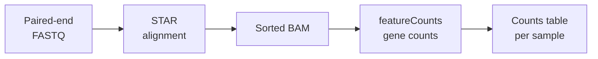

# RNA-seq Alignment and Gene Counting Workflow (Snakemake)

A small, reproducible **Snakemake** workflow that aligns paired-end RNA-seq reads to the human genome and counts reads per gene.

**In one sentence:** paired-end FASTQ files go in; a sorted BAM file and a gene count table come out.

**Tools:** Snakemake · STAR · featureCounts · Conda · Docker · DVC

---

## Workflow



| Rule | Tool | What it does |
|---|---|---|
| `star_align` | STAR | Aligns reads to the genome and writes a coordinate-sorted BAM |
| `gene_counts` | featureCounts | Counts read pairs per gene using the GENCODE annotation |

Each rule runs in its own conda environment (`envs/`), so tool versions are recorded with the code.

## Example run

| | |
|---|---|
| Sample | `SRR1551114` (NCBI SRA, paired-end) |
| Genome / annotation | Human, GENCODE v49 primary assembly |
| Status | Run end to end on this one sample |

---

## How to run

**1. Get the code**

```bash
git clone https://github.com/livolo/MLops-pipeline.git
cd MLops-pipeline
```

**2. Install Snakemake** (with conda or mamba)

```bash
conda create -n snakemake -c conda-forge -c bioconda snakemake
conda activate snakemake
```

**3. Add the input data** (not stored in the repository)

```bash
# reads
prefetch SRR1551114
fasterq-dump SRR1551114 --split-files -O data/raw

# reference: download the GRCh38 primary assembly genome FASTA and the
# GENCODE v49 primary assembly annotation (GTF) into data/reference/
```

Build the STAR index once (needs roughly 30 GB of RAM for the human genome):

```bash
STAR --runMode genomeGenerate \
  --genomeDir data/reference/star_index \
  --genomeFastaFiles data/reference/GRCh38.primary_assembly.genome.fa \
  --sjdbGTFfile data/reference/gencode.v49.primary_assembly.annotation.gtf \
  --sjdbOverhang 100 \
  --runThreadN 8
```

Set `--sjdbOverhang` to your read length minus 1.

**4. Run**

```bash
snakemake -n                       # dry run: shows what would be executed
snakemake --cores 8 --use-conda    # run the workflow
```

To process other samples, list them in `config/config.yaml`.

## Outputs

```text
results/
├── align/    <sample>.sorted.bam
└── counts/   <sample>.counts.txt  (plus featureCounts summary)
```

## Docker

A `dockerfile` builds the `rnaseq` conda environment and installs MLflow and DVC:

```bash
docker build -t rnaseq-pipeline -f dockerfile .
docker run -it rnaseq-pipeline
```

## Data versioning (DVC)

DVC is set up so that large data and results are kept out of Git. The DVC remote in `.dvc/config` points to a folder on the author's computer, so on another machine you need to download the data and reference files as described above.

## Repository structure

```text
.
├── workflow/Snakefile     # workflow rules
├── config/config.yaml     # samples and paths
├── envs/                  # conda environments (STAR, featureCounts, FastQC, combined)
├── dockerfile
├── .dvc/                  # DVC configuration
└── README.md
```

## Current limitations and next steps

- Tested on a single sample.
- There is no read quality control or trimming step yet. A FastQC environment is included for adding one.
- Count tables are produced per sample. Merging them into one matrix is planned.

## Author

**Kirti Vishwakarma**, M.Sc. Bioinformatics
[LinkedIn](https://www.linkedin.com/in/kirti-vishwakarma-b69bb9229/) · [GitHub](https://github.com/livolo)